# Azure DevOps follow-up — November 12, 2026

This increment automates deployment of the shared backend after integration into
`develop`. It supplements the earlier manual provisioning and IAM records; it does
not certify all AV2 requirements or current email delivery.

## Delivery path

```mermaid
flowchart LR
  PR["Feature PR to develop"] --> Tests["H2 and PostgreSQL tests<br/>Coverage gates"]
  Tests --> Image["Linux AMD64 Azure image<br/>Configuration and vulnerability checks"]
  Image --> Merge["Merge into develop"]
  Merge --> CI["Repeat tests and image checks<br/>for the merged commit"]
  CI --> OIDC["Branch-scoped GitHub OIDC"]
  OIDC --> ACR["Publish the same CI image<br/>Immutable SHA256 digest"]
  ACR --> ACA["Update existing Container App"]
  ACA --> Verify["Exact ready revision and digest<br/>OpenAPI 200 / anonymous 401"]
  Verify -->|Failure, attempt still owns current update| Restore["Restore and verify previous image<br/>Keep run failed"]
```

The sequence follows feature-to-develop GitFlow and Conventional Commit titles. The
API stays in the existing Azure environment; no duplicate paid environment was added.
PRs, main, tags and manual workflow runs do not deploy this environment. Pushes to
develop trigger CD, including a direct push if repository protection does not prevent
it. Branch protection is optional for this requested automation and is not represented
as enabled.

## Gates and permissions

Both database configurations execute Maven `clean verify`, including integration and
Cucumber cases. Coverage thresholds remain 85% of lines and 65% of branches. The image
is built only after those checks pass. It excludes development/local configuration,
runs as user 10001:10001 and is scanned for fixable HIGH/CRITICAL vulnerabilities.
The first scan blocked deployment; corrected runtime dependency versions are tested
through the same pipeline rather than bypassing the gate.

The deployment job downloads the same run's CI image instead of rebuilding it. It
checks the source revision/platform/user and publishes a commit/run-specific tag;
Container Apps receives an immutable digest. Deployments are serialized and superseded
commits are skipped. Verification requires the requested ready revision and image,
so the previous healthy revision alone cannot make a new deployment pass.

The separate identity `id-ecomind-github-deploy` trusts only this backend repository's
`develop` OIDC subject. It can update/read the single API and push/read the existing
registry. No client password is stored in GitHub; the three configured identifier
secrets are client ID, tenant ID and subscription ID. Runtime credentials remain in
Azure and the pipeline has no Key Vault/database/network/role-management assignment.

## Recovery and limits

On rollout or public-smoke failure, the helper restores the previous stable image
only when the failed attempt still owns the current image/revision. It verifies the
restored revision and leaves the attempted run failed. It does not reverse database
changes, external calls or business data. Backward-compatible schema changes and a
reviewed recovery plan remain part of a PR's responsibility.

The delivery runbook documents pausing CD through `AZURE_DEPLOY_ENABLED`, examining
private Azure logs and GitHub reports, operator-driven digest rollback and preserving
the existing PostgreSQL backup/restore configuration. GitHub retains tests/coverage
and vulnerability results; Dependabot proposes Maven, Actions and Docker updates.
The existing Azure metrics/logging and cost budget remain in use.

## Evidence

- [Backend PR #38](https://github.com/upc-pre-202620-13980-greenminds/EcoMind_Backend/pull/38)
- [Delivery workflow and recovery runbook](https://github.com/upc-pre-202620-13980-greenminds/EcoMind_Backend/blob/develop/docs/ci-cd.md)
- [Identity and role template](https://github.com/upc-pre-202620-13980-greenminds/EcoMind_Backend/blob/develop/infra/azure/github-deploy.bicep)

Nine offline deployment tests passed, covering exact revision/digest, public smoke,
rollback, concurrent updates and pending revisions. No forced live rollback was
performed on the shared application. Actionlint passed. ARM template
build, validation, change preview and identity/role deployment succeeded. Full CI
and the first merge-triggered Azure rollout are recorded below after observation.

## Observed CI result

[PR verification run 43316139680](https://github.com/upc-pre-202620-13980-greenminds/EcoMind_Backend/actions/runs/43316139680)
passed both database jobs, PR conventions, image configuration rejection and the
vulnerability gate. The retained image report contains zero fixable HIGH/CRITICAL
findings; this does not claim an absence of all possible vulnerabilities. The earlier
report had blocked deployment, so dependency correction was required before merging.

The backend was merged into `develop` as
`1855455769bad026a8d3e870a484dd8ea47b447f`. Its tree matches tested feature source
`d3bc693267c93aaf38c88bf76f72b42980e25598`. The merge triggered
[push run 43317087621](https://github.com/upc-pre-202620-13980-greenminds/EcoMind_Backend/actions/runs/43317087621)
automatically. Runtime publication is a separate verification, recorded after that
run finishes.

The strict AV2 audit was rerun with the current repositories and remains **NO APTO**
for delivery-wide gaps/manual reviews. The workflow evidence above is scoped to
backend DevOps and does not override those findings or close participant validation,
physical-device evidence, videos or unrelated backlog work.

The artifact follow-up in [Backend PR #39](https://github.com/upc-pre-202620-13980-greenminds/EcoMind_Backend/pull/39)
removes the unused general Maven JAR upload, which can include development resources.
The pipeline uses the separately validated Azure image instead. General JAR artifacts
created during this automation task were removed; test/coverage and vulnerability
reports were retained. No runtime credentials or private fixtures are included here.

The first real push run stopped at Azure login before publishing an image or changing
the API. GitHub's actual assertion uses immutable owner/repository IDs, while the
initial template expected the legacy name-only subject. The trust was corrected to
`repo:upc-pre-202620-13980-greenminds@323838917/EcoMind_Backend@1391221057:ref:refs/heads/develop`,
matching both the observed assertion and repository metadata. No wildcard or broader
branch trust was added. [GitHub's immutable-subject documentation](https://docs.github.com/en/actions/reference/security/oidc#immutable-subject-claims)
explains the format. This setup failure is retained separately from the corrected
runtime verification below.

## First verified publication

After correcting the federated subject, push run `43317087621`, attempt 2, completed
successfully. The failed-job retry reused the already verified CI image; no application
image was built or deployed manually. Azure independently reported:

- Revision `ca-ecomind-api--gh-43317087621-2`, active, Healthy, Provisioned and Running.
- Image digest `sha256:91dfd7b1c28137a7f729848ee21f24d74ad37fb3468185916339339f9fcc30c3`.
- Merged source `1855455769bad026a8d3e870a484dd8ea47b447f`.

The run verified the exact requested revision/digest and public HTTP checks. The
initial authentication setup failure is not represented as a successful first attempt.
The next merge's fully automatic result is recorded separately below.

## Final merged verification

Backend PR #39 was merged as `dafd261711ddf3cf3a4c084c4220e92e754b7621`, with a
tree identical to tested source `3afef07b0e4408ea2a478356afd754dbe7b4d298`.
[Push run 43319120978](https://github.com/upc-pre-202620-13980-greenminds/EcoMind_Backend/actions/runs/43319120978)
was triggered automatically by that merge, with no manual dispatch or retry.

The retained Surefire/JaCoCo artifacts from that push show:

| Database | Tests | Failures/errors/skips | Line coverage | Branch coverage |
| --- | ---: | --- | --- | --- |
| h2 | 698 | 0 / 0 / 0 | 8587/9975 (86.09%) | 1978/2802 (70.59%) |
| postgresql | 698 | 0 / 0 / 0 | 8589/9975 (86.11%) | 1978/2802 (70.59%) |

The nine isolated deployment-helper tests also passed. The final image scan report
contains zero fixable HIGH/CRITICAL findings. No general Maven JAR artifact was
uploaded; test/coverage reports and the deployment-safe image were retained.

## Final automatic deployment result

Push run **43319120978 completed successfully on attempt 1**, including Azure login,
image publication and runtime verification. It was triggered solely by the merge into
`develop`; no manual dispatch, retry or local deployment command was required.

Azure independently reported `ca-ecomind-api--gh-43319120978-1` as the latest ready
revision, active, Healthy, Provisioned and Running. Its immutable image digest is
`sha256:48e53a2b203f4434304a9ce8abe8446cc6eb2f58287a1f570aa0b301cbabba31`.
Public verification returned OpenAPI 200 with 133 documented paths and anonymous
account access 401. The endpoint used by both mobile apps is unchanged.

[Sanitized execution evidence](azure-devops-validation-2026-11-12.json) records the
source, run, tests, coverage, image, revision and limits. GitHub's ordinary push event
now performs the full path `tests → coverage → image/scan → publish → rollout → health`.
Optional branch protection does not gate this requested automation. Image rollback is
implemented and covered by offline safety tests; no forced live failure was introduced.

## Email routing completion

Azure Communication Services Email now serves production IAM verification and password
recovery from its Europe resource. The healthy production revision delivered actual
registration and recovery messages; API confirmation, consumed-token rejection and
mail authentication checks passed. The public API and recovery URL remain unchanged.
This records the verified service path and two controlled mail checks; it does not
guarantee inbox placement for other recipients.
